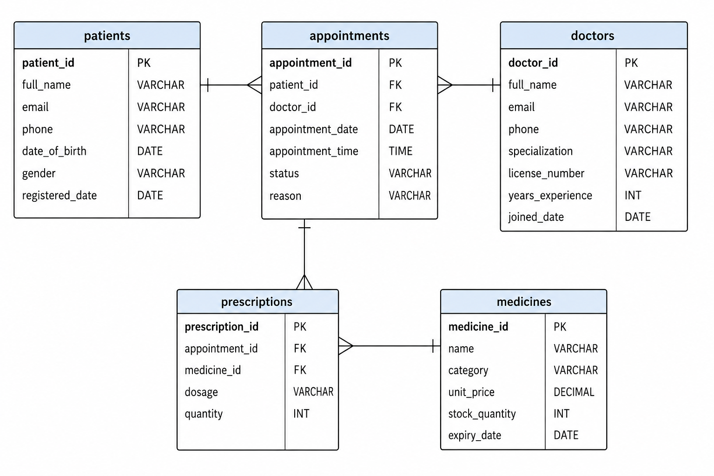
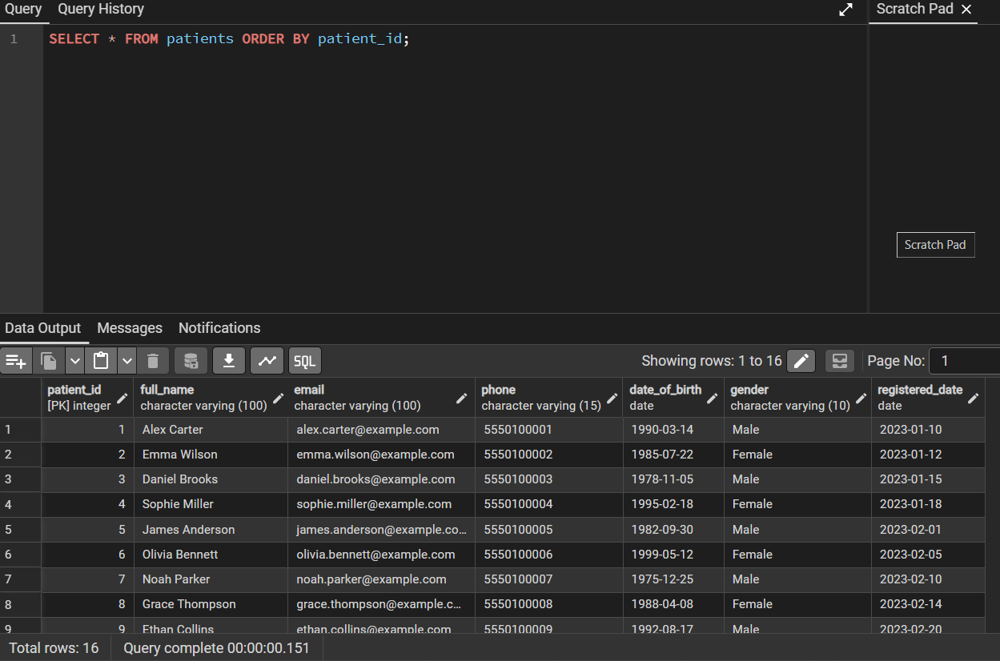
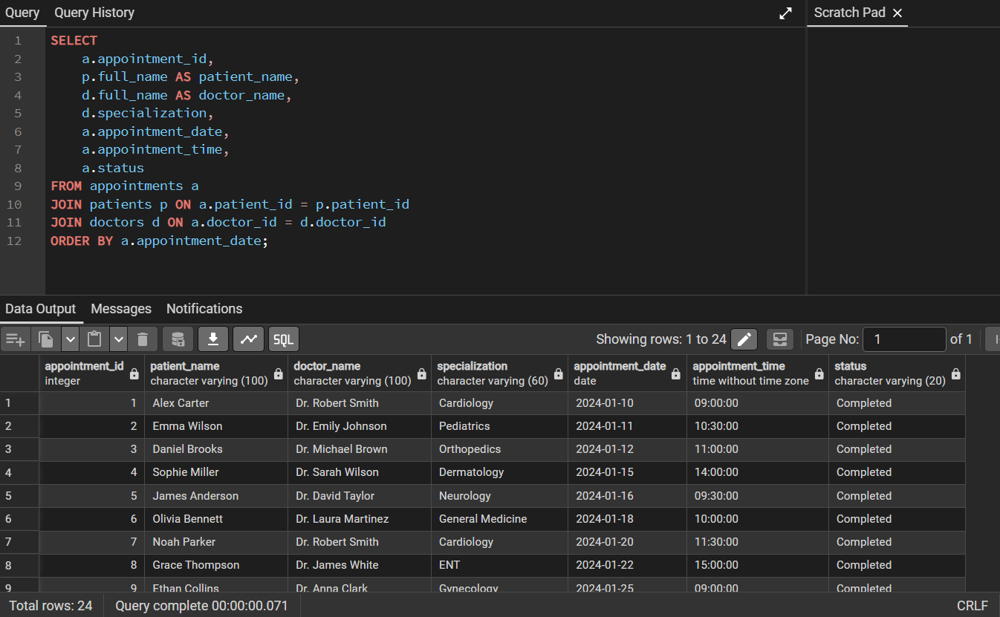
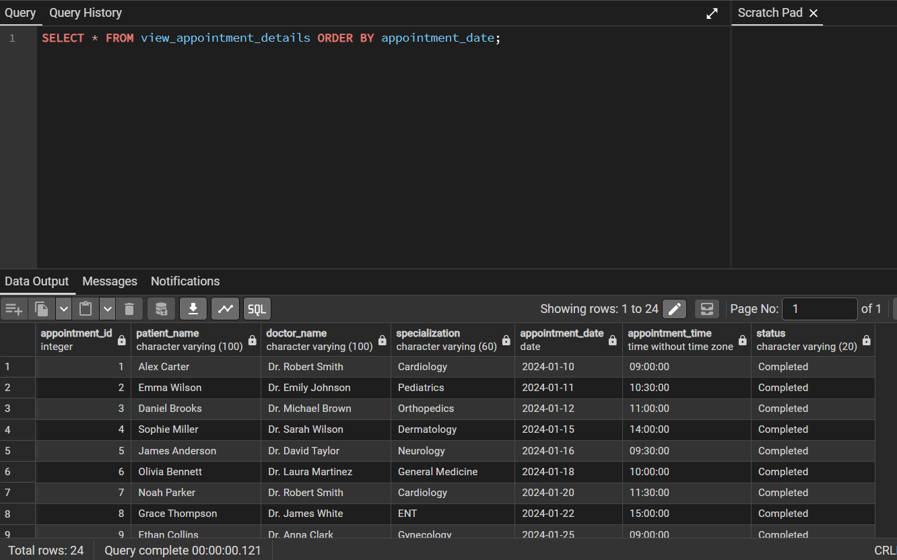
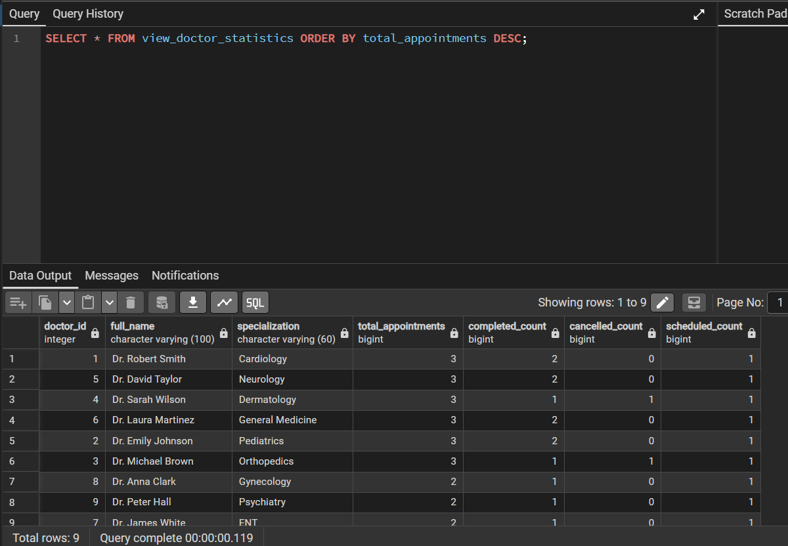
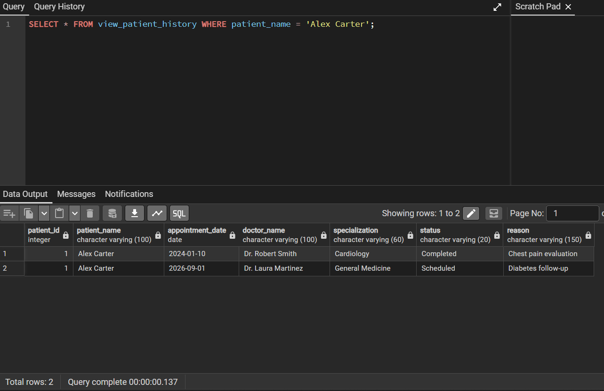

# Hospital Management System

A PostgreSQL-based relational database for managing hospital operations: patient records, doctor profiles, appointment scheduling, and medicine prescriptions. The project demonstrates practical relational database design using joins, views, and constraints.

## Overview

This system models a hospital's core operations — registering patients, managing doctor profiles by specialization, scheduling appointments with statuses (Scheduled, Completed, Cancelled), tracking medicine inventory, and recording prescriptions issued during appointments.

## Features

- Patient and doctor record management
- Appointment scheduling with status tracking
- Medicine inventory with stock and expiry tracking
- Prescription records linking appointments to medicines
- Reusable SQL views for common lookups (appointment details, doctor statistics, patient history)
- A wide range of SQL queries covering joins, aggregates, subqueries, and date logic

## Technologies Used

- PostgreSQL
- pgAdmin
- SQL (DDL, DML, DQL, Views)
- Git & GitHub

## Database Design

**Tables:** `patients`, `doctors`, `appointments`, `medicines`, `prescriptions`

`prescriptions` is a supporting table representing the many-to-many relationship between `appointments` and `medicines` — an appointment can prescribe multiple medicines, and a medicine can appear across many appointments.

## Database Tables

**patients**: patient_id (PK), full_name, email (unique), phone (unique), date_of_birth, gender, registered_date

**doctors**: doctor_id (PK), full_name, email (unique), phone (unique), specialization, license_number (unique), years_experience, joined_date

**medicines**: medicine_id (PK), name, category, unit_price, stock_quantity, expiry_date

**appointments**: appointment_id (PK), patient_id (FK), doctor_id (FK), appointment_date, appointment_time, status (Scheduled/Completed/Cancelled), reason

**prescriptions**: prescription_id (PK), appointment_id (FK), medicine_id (FK), dosage, quantity

## Relationships

- `patients` (1) → (many) `appointments`
- `doctors` (1) → (many) `appointments`
- `appointments` (1) → (many) `prescriptions`
- `medicines` (1) → (many) `prescriptions`

## ER Diagram



## SQL Concepts Demonstrated

- Primary keys, foreign keys, `CHECK`, `UNIQUE`, `DEFAULT` constraints
- `INNER JOIN`, `LEFT JOIN`, and multi-table joins
- `GROUP BY`, `HAVING`
- Aggregate functions (`COUNT`, `SUM`, `AVG`)
- `CASE` expressions
- Subqueries
- Date/time operations (`INTERVAL`, date differences)
- Reusable SQL views

## Views

- **view_appointment_details** — appointment info joined with patient and doctor names
- **view_doctor_statistics** — per-doctor appointment counts by status
- **view_patient_history** — full appointment/medicine history per patient

```sql
SELECT * FROM view_appointment_details ORDER BY appointment_date;
SELECT * FROM view_doctor_statistics ORDER BY total_appointments DESC;
SELECT * FROM view_patient_history WHERE patient_name = 'Alex Carter';
```

## Example Queries

Multi-table join across appointments, patients, doctors, and prescribed medicines:

```sql
SELECT p.full_name AS patient_name, d.full_name AS doctor_name,
       a.appointment_date, m.name AS medicine_name, pr.dosage, pr.quantity
FROM prescriptions pr
JOIN appointments a ON pr.appointment_id = a.appointment_id
JOIN patients p ON a.patient_id = p.patient_id
JOIN doctors d ON a.doctor_id = d.doctor_id
JOIN medicines m ON pr.medicine_id = m.medicine_id
ORDER BY a.appointment_date;
```

See [`sql/03_queries.sql`](sql/03_queries.sql) for the full set of queries.

## Screenshots

**All Patients**


**Doctors & Appointments**


**Appointment Details View**


**Doctor Statistics View**


**Patient History View**


## Project Structure

```
hospital-management-system/
│
├── README.md
├── sql/
│   ├── 01_create_tables.sql
│   ├── 02_insert_data.sql
│   └── 03_queries.sql
├── views/
│   └── 01_create_views.sql
├── diagrams/
│   └── ER_diagram.png
└── screenshots/
    ├── patients_table.png
    ├── doctors_appointments.png
    ├── appointment_details.png
    ├── doctor_statistics.png
    └── view_results.png
```

## How to Run

1. Install PostgreSQL and pgAdmin
2. Create a database named `hospital_management_system`
3. Run `sql/01_create_tables.sql`
4. Run `sql/02_insert_data.sql`
5. Run `sql/03_queries.sql` to explore query examples
6. Run `views/01_create_views.sql` and query the views

## Future Improvements

- Add a `billing` table for invoicing appointments and medicines
- Add triggers to auto-decrement medicine stock on prescription
- Add role-based access for doctors, admin staff, and patients
- Build a front-end interface on top of this schema

## Author
Vipin T K 